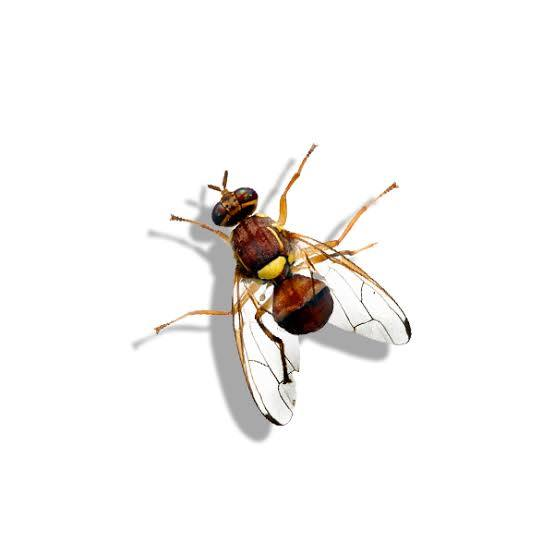
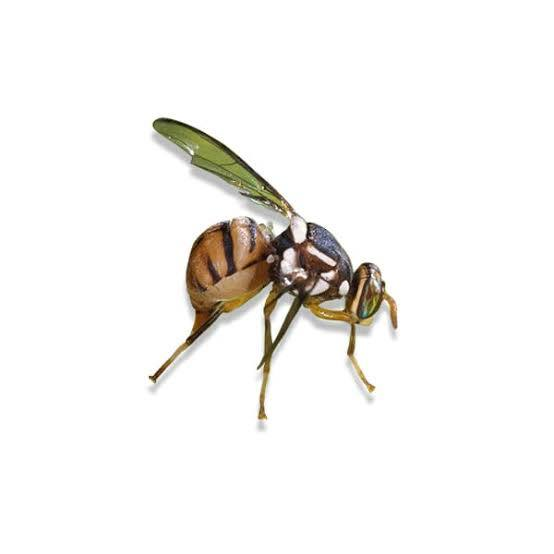

Described by Macquart in 1835. Primarily Indo-Pacific in distribution, with several species
now established as invasive pests in Africa, Europe, and the Americas.

**Tribe:** Dacini | **Species:** ~600

{width=60%}

---

## *Bactrocera dorsalis* (Hendel, 1912) {#sec-b-dorsalis}

**Common name:** Oriental fruit fly  
**Economic importance:** Major invasive pest of mango, guava, papaya, and hundreds of other
hosts. Established in Africa after 2003.

{width=50%}

---

### Research {.panel-tabset}

#### Gut Microbiota

::: {.panel-tabset group="gut"}

##### Community and Composition

::: {.callout-note appearance="minimal"}
#### *Bactrocera dorsalis* and its gut microbiota: an emerging insect model (2026)
**Researchers:** Qiongyi Zhou, Hongyu Zhang  
[Read paper →](https://doi.org/10.3390/insects17070662)
:::

::: {.callout-note appearance="minimal"}
#### Gut microbiota are involved in adaptation of *B. dorsalis* to temperature and diet stressors (2026)
**Researchers:** Abir Hafsi, Massimiliano Virgilio  
[Read paper →](https://hal.science/hal-05774781v1/file/619332.pdf)
:::

##### Fitness, Immunity & Survival

::: {.callout-note appearance="minimal"}
#### Excess sucrose in the larval diet alters gut microbiota and reduces body size and longevity (2026)
**Researchers:** Xiaoyun Jia, Zihua Zhao  
[Read paper →](https://link.springer.com/article/10.1007/s13744-026-01404-8)
:::

::: {.callout-note appearance="minimal"}
#### BdNOX5 mediates gut microbiota homeostasis via ROS regulation (2026)
**Researchers:** Tian Zeng, Yi-juan Xu  
[Read paper →](https://scijournals.onlinelibrary.wiley.com/doi/10.1002/ps.70506)
:::

::: {.callout-note appearance="minimal"}
#### Cuticle-associated microbiota suppress fungal infection through immune and chemical defences (2026)
**Researchers:** Kamil Kabir, Hongyu Zhang  
[Read paper →](https://scijournals.onlinelibrary.wiley.com/doi/10.1002/ps.70704)
:::

::: {.callout-note appearance="minimal"}
#### Gut-microbiota reshaping by oxytetracycline residues threatens life-history traits (2026)
**Researchers:** Yuxin Yang, Zihua Zhao  
[Read paper →](https://www.sciencedirect.com/science/article/abs/pii/S0304389426017681)
:::

##### Behaviour

::: {.callout-note appearance="minimal"}
#### Bacterial-driven odorant receptor expression shifts alter olfactory behaviour in the oriental fruit fly (2026)
**Researchers:** Muyang He, Yonghao Lu  
[Read paper →](https://resjournals.onlinelibrary.wiley.com/doi/full/10.1111/een.70045)
:::

:::

#### Pest Control Applications

::: {.panel-tabset group="pestcontrol"}

##### Biological & Nucleic Acid

::: {.callout-note appearance="minimal"}
#### RNAi-mediated immune suppression enhances *Serratia marcescens* pathogenicity (2026)
**Researchers:** B. Wei, Y. Liu  
[Read paper →](https://doi.org/10.1007/s10340)
:::

::: {.callout-note appearance="minimal"}
#### Novel defensin-like antimicrobial peptides as promising targets for control (2026)
**Researchers:** Bing Xie, Bin Song  
[Read paper →](https://scijournals.onlinelibrary.wiley.com/doi/10.1002/ps.70805)
:::

::: {.callout-note appearance="minimal"}
#### Construction of a chitosan nanoparticle-based nucleic acid pesticide system for the control of *Bactrocera dorsalis* (2026)
**Researchers:** Guijian Zhang, Changying Niu  
[Read paper →](https://doi.org/10.1007/s10340-025-01984-1)
:::

##### Field Management

::: {.callout-note appearance="minimal"}
#### Integration of insecticides with methyl eugenol-based male annihilation technique trap device enhances the management of *Bactrocera dorsalis* in sweet orange orchard (2026)
**Researchers:** Gelana Keno Beyene, Gebissa Yigezu  
**Affiliation:** (TBC — Ethiopia)  
[Read paper →](https://doi.org/10.1155/aia/5346922)
:::

::: {.callout-note appearance="minimal"}
#### Development and field evaluation of a lure-and-infect strategy integrating attractants with *Beauveria bassiana* for controlling *Bactrocera dorsalis* (2026)
**Researchers:** Jingpeng Xie, Fengqin Cao  
**Journal:** *Journal of Pest Science*  
[Read paper →](https://doi.org/10.1007/s10340-026-02054-w)
:::

##### Detection & Biosensors

::: {.callout-note appearance="minimal"}
#### MOF-enhanced colorimetric sensor array for early detection of citrus infestation by *Bactrocera dorsalis* (2026)
**Researchers:** Xin Zhang, Tao Wen  
**Journal:** (Postharvest Biology and Technology)  
[Read paper →](10.1016/j.postharvbio.2026.114242)
:::

:::

#### Gene Drives

::: {.panel-tabset group="genedrives"}

##### White Pupae Lines

::: {.callout-note appearance="minimal"}
#### CRISPR/Cas9-based white pupae mutant lines in *Bactrocera* spp. for sterile insect technique applications (2026)
**Researchers:** Chrysanthi Ioannidou, Kostas Bourtzis  
[Read paper →](https://doi.org/10.1111/1744-7917.70190)
:::

##### CRISPR Toolkit and pgSIT

::: {.callout-note appearance="minimal"}
#### CRISPR/Cas9-mediated genome editing in the management of *Bactrocera dorsalis* (2026)
**Researchers:** (first author TBC), (last author TBC)  
[Read paper →](https://link.springer.com/protocol/10.1007/978-1-0716-4746-2_18)
:::

::: {.callout-note appearance="minimal"}
#### Next-generation genetic biocontrol technologies for tephritid pests (2026)
**Researchers:** (first author TBC), (last author TBC)  
[Read paper →](https://doi.org/10.1080/19336934.2026.2682509)
:::

:::

#### Ecology & Behaviour

::: {.panel-tabset group="ecology"}

##### Dispersal & Migration

::: {.callout-note appearance="minimal"}
#### Flight characteristics of *Bactrocera dorsalis* associated with long-distance migration (2026)
**Researchers:** Naoya Hidaka, Akira Otuka  
[Read paper →](https://doi.org/10.3390/insects17020203)
:::

##### Thermal Biology

::: {.callout-note appearance="minimal"}
#### Temperature experienced prior to adult emergence modulates adult cold tolerance of the invasive tephritid species *Bactrocera dorsalis* and *Bactrocera zonata* (2026)
**Researchers:** Vasilis G. Rodovitis, Nikos T. Papadopoulos  
[Read paper →]()
:::

##### Ecotoxicology

::: {.callout-note appearance="minimal"}
#### Cadmium exposure triggers adaptive physiological and molecular responses that undermine development in *Bactrocera dorsalis* (2026)
**Researchers:** Wei Zhao, Dan-Dan Wei  
**Journal:** *Ecotoxicology and Environmental Safety*  
[Read paper →](https://doi.org/10.1016/j.ecoenv.2026.120524)
:::

##### Sensory Biology & Olfaction

::: {.callout-note appearance="minimal"}
#### Asymmetric evolution of antennal cell types underlies a derived ammonia-sensing logic for ecological adaptation in *Bactrocera dorsalis* (2026)
**Researchers:** Wei Liu, Guirong Wang  
**Journal:** *Advanced Science*  
[Read paper →](https://doi.org/10.1002/advs.77168)
:::

::: {.callout-note appearance="minimal"}
#### N-(3-methylbutyl)acetamide mediates male–male courtship in *Bactrocera dorsalis* through behavioural threshold modulation (2026)
**Researchers:** Yuhua Zhang, Xin Yi  
**Journal:** *PNAS*  
[Read paper →](https://doi.org/10.1073/pnas.2605503123)
:::

::: {.callout-note appearance="minimal"}
#### Understanding the chemosensory and detoxification mechanisms in the oriental fruit fly, *Bactrocera dorsalis* (2026)
**Researchers:** Saleem Jaffar, Yongyue Lu  
**Affiliation:** South China Agricultural University, Guangzhou, China  
**Journal:** * Insect Transcriptomics*  
[Read paper →](https://doi.org/10.3390/insects17040416)
:::

##### Distribution & Surveillance

::: {.callout-note appearance="minimal"}
#### *Bactrocera dorsalis* dominance and first report of three *Dacus* species in Uganda (2026)
**Researchers:** Denish Oyaro Onen, Jeninah Karungi  
**Affiliation:** Makerere University, Uganda  
[Read paper →](https://doi.org/10.1016/j.sciaf.2026.e03286)
:::

::: {.callout-note appearance="minimal"}
#### Survey parameters to support detection survey design for *Bactrocera dorsalis* (2026)
**Researchers:** Daria Rzepecka, Sybren Vos  
**Affiliation:** European Food Safety Authority (EFSA)  
[Read paper →](https://doi.org/10.2903/sp.efsa.2026.EN-10407)
:::

:::

#### Transcriptomics

*No papers added yet.*

#### Researchers

::: {.grid}

::: {.g-col-12 .g-col-md-4}
::: {.callout-note appearance="minimal"}
#### Hong-Yu Zhang
**Affiliation:** Huazhong Agricultural University, China  
**Themes:** Gut microbiota, immune defence, RNAi  
[ResearchGate →](https://www.researchgate.net/profile/Hongyu-Zhang-61)
:::
:::

::: {.g-col-12 .g-col-md-4}
::: {.callout-note appearance="minimal"}
#### Zihua Zhao
**Affiliation:** China Agricultural University  
**Themes:** Life-history, diet, gut microbiota composition  
[Google Scholar →](https://scholar.google.com/citations?user=-7U97kMAAAAJ&hl=zh-CN)
:::
:::

::: {.g-col-12 .g-col-md-4}
::: {.callout-note appearance="minimal"}
#### Massimiliano Virgilio
**Affiliation:** Royal Museum for Central Africa, Belgium  
**Themes:** Phylogenetics, population genetics, microbiome adaptation  
[Affiliation →](https://www.africamuseum.be/en/staff/896)  
[Google Scholar →](https://scholar.google.com/citations?user=Nl7sTl8AAAAJ&hl=en&oi=sra)
:::
:::

::: {.g-col-12 .g-col-md-4}
::: {.callout-note appearance="minimal"}
#### Tian Zeng
**Affiliation:** (TBC)  
**Themes:** Gut homeostasis, ROS regulation  
[ResearchGate →](https://www.researchgate.net/profile/Tian-Zeng-22)
:::
:::

::: {.g-col-12 .g-col-md-4}
::: {.callout-note appearance="minimal"}
#### Kamil Kabir
**Affiliation:** (TBC)  
**Themes:** Cuticle microbiota, immune defence, fungal resistance  
[ORCID →](https://orcid.org/0009-0006-3893-7423)
:::
:::

::: {.g-col-12 .g-col-md-4}
::: {.callout-note appearance="minimal"}
#### Guirong Wang
**Affiliation:** Institute of Zoology, Chinese Academy of Sciences  
**Themes:** Sensory biology, olfaction, chemosensory evolution  
:::
:::

::: {.g-col-12 .g-col-md-4}
::: {.callout-note appearance="minimal"}
#### Nikos T. Papadopoulos
**Affiliation:** University of Thessaly, Greece  
**Themes:** Thermal biology, dispersal, life history  
:::
:::

::: {.g-col-12 .g-col-md-4}
::: {.callout-note appearance="minimal"}
#### Dan-Dan Wei
**Affiliation:** Southwest University, China  
**Themes:** Ecotoxicology, nucleic acid pesticides, development  
:::
:::

:::