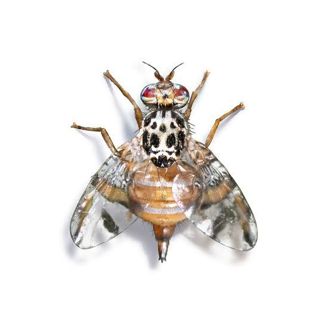

# *Ceratitis*

Described by Macleay in 1829. Primarily Afrotropical in distribution, with *C. capitata*
now cosmopolitan.

**Tribe:** Ceratitidini | **Species:** ~78

---

## *Ceratitis capitata* (Wiedemann, 1824) {#sec-c-capitata}

**Common name:** Mediterranean fruit fly (Medfly)  
**Economic importance:** One of the world's most polyphagous pests, infesting over 300
host species. Established on every inhabited continent except Asia. Managed primarily
through the Sterile Insect Technique (SIT).

{width=60%}

---

### Research {.panel-tabset}

#### Gut Microbiota

::: {.panel-tabset}

##### Community and Composition

::: {.callout-note appearance="minimal"}
#### Dominance of *Zygosaccharomyces* and shifts in bacterial pathways: effects of antimicrobials on composition and diversity of the *C. capitata* bacterial and fungal microbiome (2026)
**Researchers:** Maria Cecilia Rasuk, Alfonsina Palladini  
[Read paper →](https://doi.org/10.1371/journal.pone.0335811)
:::

##### Fitness, Immunity & Survival

::: {.callout-note appearance="minimal"}
#### *Ceratitis capitata* microbiota and its effect on environmental stress tolerance: making flies stronger (2026)
**Researchers:** Alfonsina Palladini, Juan Rull  
[Read paper →](https://doi.org/10.1111/1744-7917.70010)
:::

##### Behaviour

*No papers added yet.*

##### Pest Control Applications

::: {.callout-note appearance="minimal"}
#### Probiotic modulation of gut microbiota enhances immunity and nutrition in SIT *C. capitata* sterile males (2026)
**Researchers:** Kamel Charaabi, (last author TBC)  
[Read paper →](https://doi.org/10.1007/s00248-026-02754-x)
:::

:::

#### Gene Drives

::: {.panel-tabset}

##### CRISPR Tooling

::: {.callout-note appearance="minimal"}
#### A novel polymerase III promoter for gene editing in *Ceratitis capitata* (2026)
**Researchers:** Amber S. K., Philip T. Leftwich  
[Read paper →](https://doi.org/10.64898/2026.04.21.719894)
:::

##### Cisgenic Sexing Strains

::: {.callout-note appearance="minimal"}
#### Generating cisgenic sexing strains in insect pests (2026)
**Researchers:** Serafima Davydova, Angela Meccariello  
[Read paper →](https://www.nature.com/articles/s42003-026-09624-9)
:::

:::

#### Researchers

::: {.grid}

::: {.g-col-12 .g-col-md-4}
::: {.callout-note appearance="minimal"}
#### Philip Leftwich
**Affiliation:** University of East Anglia, UK  
**Themes:** Gene drives, gut microbiota
[Personal website →](https://philip-leftwich.github.io)
:::
:::

::: {.g-col-12 .g-col-md-4}
::: {.callout-note appearance="minimal"}
#### Tracey Chapman
**Affiliation:** University of East Anglia, UK  
**Themes:** Gut microbiota, development gene drives 
[Google Scholar →](https://scholar.google.com/citations?user=aE7Q7CMAAAAJ&hl=en)
:::
:::

::: {.g-col-12 .g-col-md-4}
::: {.callout-note appearance="minimal"}
#### Charles Mason
**Affiliation:** (TBC)  
**Themes:** (TBC)
[Google Scholar →](https://scholar.google.com/citations?hl=en&user=ih4bYs8AAAAJ&view_op=list_works&sortby=pubdate)
:::
:::

::: {.g-col-12 .g-col-md-4}
::: {.callout-note appearance="minimal"}
#### Angela Meccariello
**Affiliation:** Imperial College London, UK 
**Themes:** Cisgenic sexing strains, gene drives
[Google Scholar →](https://scholar.google.com/citations?user=rXXpQNwAAAAJ&hl=it)
:::
:::

:::