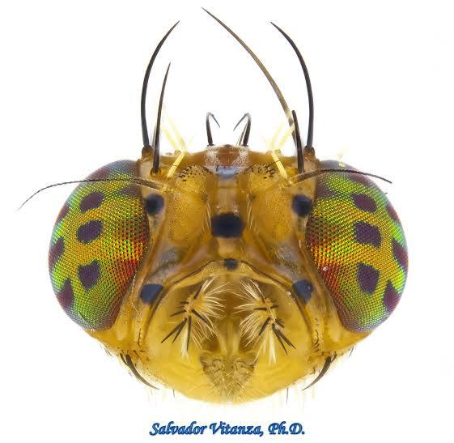

{width=60% fig-align="center" style="border-radius:8px; margin-bottom:1.5rem;"}

This database covers empirical research on tephritid fruit flies (family **Tephritidae**),
organised by genus and species. Each page documents active research themes, key papers,
and the researchers behind them. Currently focused on 2026 publications.

---

## Genera Covered

::: {.grid}

::: {.g-col-12 .g-col-md-4}
::: {.callout-note appearance="minimal"}
### *Bactrocera*
~600 species · Tribe Dacini  
Indo-Pacific, invasive globally  
**Research:** Gut microbiota, gene drives, transcriptomics  
[Go to page →](bactrocera.qmd)
:::
:::

::: {.g-col-12 .g-col-md-4}
::: {.callout-note appearance="minimal"}
### *Ceratitis*
~78 species · Tribe Ceratitidini  
Afrotropical, *C. capitata* cosmopolitan  
**Research:** Gut microbiota, gene drives, SIT  
[Go to page →](ceratitis.qmd)
:::
:::

::: {.g-col-12 .g-col-md-4}
::: {.callout-note appearance="minimal"}
### *Anastrepha*
~328 species · Tribe Toxotrypanini  
Neotropical  
**Research:** Coming soon  
:::
:::

:::

---

## About

Papers are sourced from Google Scholar, PubMed, and Web of Science. Only empirical
research papers are included — reviews are excluded unless otherwise noted. Coverage
is currently limited to 2026 publications and will be extended retrospectively.

> For questions or contributions contact: katie.millar@uea.ac.uk